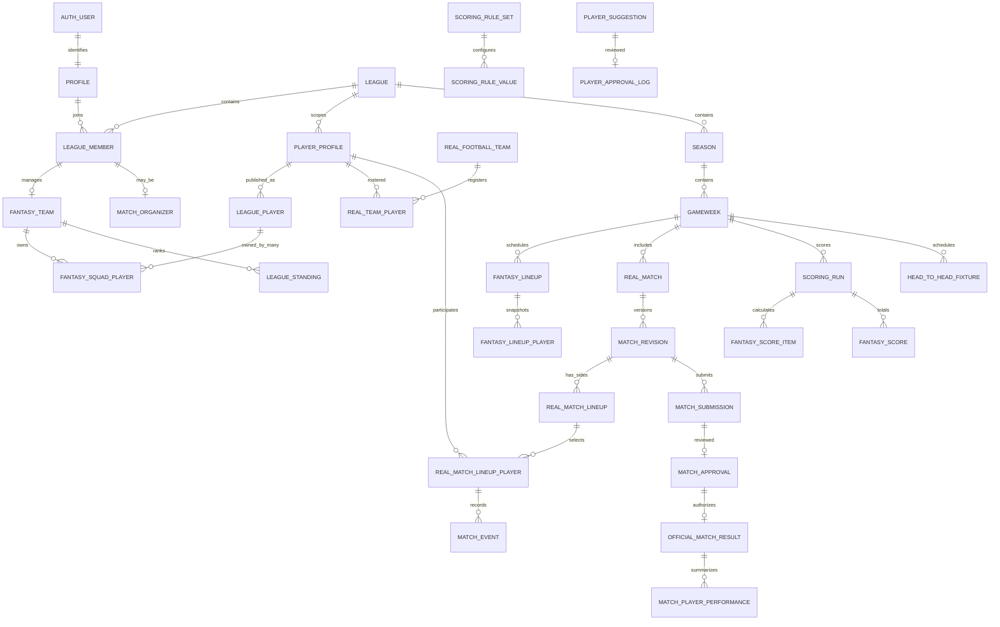

# Fantasy Friends — Phase 2A architecture review

**Status: offline, non-deployable design draft; no live project, backend integration or frontend changes.** The SQL files are intentionally under `supabase/design/migrations/`, not the Supabase CLI's `supabase/migrations/`. There are **no client write grants, workflow RPCs, scoring jobs, Storage upload policies, or live credentials**. Nothing in this design may be moved to a deployable migrations directory until all gates below are met. Existing local demo and IndexedDB image picker remain unchanged.

## Existing application and mapping

The Vite/React app uses `useDemo` and `fantasy-friends-demo-v1` localStorage; images are IndexedDB blobs with `local-image:` references. It has independent league markets and suggestions; demo-only leader/manager switching; 15 players (2 GK/5 DEF/5 MID/3 FWD), 11 starters/4 bench, seven formations, 100M budget, C/VC, same-position transfers, player sheets and substitutions. First 11 array entries are starters. The market permits ownership of the same player by many fantasy teams. Points, fixtures, standings and match data are static examples, not results of any engine. Roles are not security in this demo.

`profiles` maps to an authenticated **app user**; active `league_members` are **fantasy managers** or leaders (a leader may also manage a fantasy team). `player_profiles` are **real people** with no account requirement; `real_football_teams` and membership are independent of `fantasy_teams` and `fantasy_squad_players`. `league_players` is a league's price, rating, position and market status for a real player, not their fantasy ownership. In this draft player identity is league-scoped: the same human in two leagues has separate profile IDs until explicit, consent-aware identity linking is designed. Never equate the two types of user or infer identity from a display name.

## Domain diagram

The actual SQL uses UUID primary keys and composite `(league_id, id)` references to prevent cross-league associations, with explicit `ON DELETE RESTRICT`. The intended lifecycle deactivates teams/players rather than deleting them; versioned lineup and score rows use restrictive references, but privileged deletion or modification is not prevented. `league_members` retains inactive members, and identity deletion/pseudonymization needs a separate reviewed retention policy. `real_team_players` has time-bounded membership; `temporary_participant_authorizations` records a member actor and a match/team/player reason; the intended leader-only authorization is not yet enforced. Each match has two distinct same-league real teams; a fantasy head-to-head fixture instead has two distinct same-league **fantasy teams**. `real_match_lineup_players` has `unique(revision_id,player_id)` across both sides, preventing duplicates on either side. One `(fantasy_team_id, league_player_id)` primary key prevents duplicates in a single squad, but there is intentionally no league-wide ownership uniqueness.

## Schema groups and constraints

| Group | Tables / purpose | Key constraints and indexes |
|---|---|---|
| Identity | `profiles`, `leagues`, `league_members`, `match_organizers` | auth identity FK; membership PK; at most one active leader; organizer must be a member. Bootstrap/transfer of leadership requires a reviewed privileged transaction. |
| Real football / market | `player_profiles`, `real_football_teams`, `real_team_players`, `league_players`, `player_suggestions`, `player_approval_logs`, `temporary_participant_authorizations` | composite tenant FKs; unique market player per league/person; pending normalized-name index; one approval and one league-player association per suggestion. Names alone are not reliable identity; false duplicate resolution must be reviewed. |
| Fantasy teams | `fantasy_teams`, `fantasy_squad_players`, `fantasy_lineups`, `fantasy_lineup_players`, `transfers` | one team per member/league; unique player per squad/lineup, slot 1–15, one C/VC each; index for multi-ownership; versioned lineup and price snapshot fields and transfer history (privileged-write immutability is not yet enforced). |
| Match and review | `seasons`, `gameweeks`, `real_matches`, `match_revisions`, `real_match_lineups`, `real_match_lineup_players`, `match_events`, `match_submissions`, `match_approvals`, `official_match_results` | match/team and revision tenant FKs; distinct sides; unique player per revision; events FK to lineup; one decision per submission; result submission references an approved lineup decision for the same match; official result FK requires an approved **result** decision for the exact revision. One current result per match. |
| Scoring and results | `scoring_rule_sets`, `scoring_rule_values`, `match_player_performances`, `scoring_runs`, `fantasy_score_items`, `fantasy_scores`, `head_to_head_fixtures`, `league_standings` | version per league; position/event rule key; zero configured values; one performance per player/result revision; gameweek can reference a rule set (immutable pinning is not enforced); unique run input hash; one complete current run; per-team/per-player attribution and explicit ×1/×2 multiplier; separate standings modes. |
| Cross-cutting | `notifications`, `audit_logs` | tenant and recipient references; audit indexed by entity/time. No authenticated writes or deletes; future RPCs append audit in the same transaction. |

Indexes are included for member lookups, roster eligibility, market filters, ownership, transfers, match gameweeks/events, fixture lookup, notifications and audit entity/time. All other unique constraints also create indexes. Query plans, missing FK indexes, partitioning, retention and load targets require validation on real Postgres before production.

## Decisions that MUST be resolved

1. **Standings conflict:** the most recent UI requirement is fantasy-points-only with shared ranks; Phase 2A also asks for head-to-head win=3/draw=1/loss=0 and fantasy points as criterion/tiebreaker. The draft supports **two separate modes**, not a single ambiguous ranking. Confirm which is league default, whether both are visible, tie treatment and whether H2H mode may be changed mid-season. Do not alter the current UI implicitly.
2. Final position/event scores, appearances/minutes, clean sheet, win/draw attribution, bonus/custom events, rounding, vice fallback, bench/autosub ordering and eligibility, voids, deadlines, postponed/multiple real matches, and correction deadlines are **pending**. Only ×2 captain and H2H 3/1/0 are specified; no other scoring numbers are seeded. A draft rule set is not a default scoring policy.
3. Exact duplicate-person matching, guest authorization and proof, role delegation and leader-as-organizer/reviewer conflicts, schedule/time-zone/DST, venue privacy, invitation lifecycle, deletion and retention/consent rules, media moderation, and anti-abuse/rate limits require product/legal review.
4. Monetary units: SQL uses exact `numeric` in absolute currency units; frontend demo uses `100` for 100M. Migration must explicitly convert ×1,000,000, with checked precision and rounding. PostgREST numeric-to-JS conversion needs precision testing or a decimal/string API contract.
5. Visibility policy for other managers' squads/lineups, draft player identity and match submission privacy is conservative, not a final product decision. Managers can read public-in-league fantasy team/score summary, but draft squads and lineups are owner/leader only.

## Invariants not yet enforced by the draft

The migrations model relationships and deny all client mutations. They are **not an operational backend**: table owners can bypass RLS, and constraints alone do not validate a real team's roster at the match date, a lineup team's membership in the match, starter/substitute counts, immutable submitted snapshots, organizer/leader authorization of writes, pending approval transitions, squad budget/distribution/deadline, version immutability, audit completeness, approved result consistency with its approved lineup, event semantics, scoring aggregation or idempotent re-scoring. Approved-result FKs alone do not prove the data was created by an authorized actor. These checks must be implemented inside trusted transactions and tested before granting any write or exposing official scores. The current schema intentionally grants no DML/RPC to clients, so it cannot generate official points at all.

Final requirement-by-requirement audit and concrete owner-role gap witnesses: [final review](final-review.md). The browser failure investigation is recorded [here](browser-investigation.md).

Detailed contracts and gates: [match workflow](match-workflow.md), [scoring workflow](scoring-workflow.md), [security and storage](security.md), and [test plan and roadmap](test-plan.md). Draft TypeScript types in `src/types/database.design.ts` are generated from the offline draft, **not** from a Supabase deployment; write shapes do not grant permission. Use `npm run types:db:design` to regenerate. Replace with actual CLI-generated types only after a separately approved local Supabase schema is finalized.
